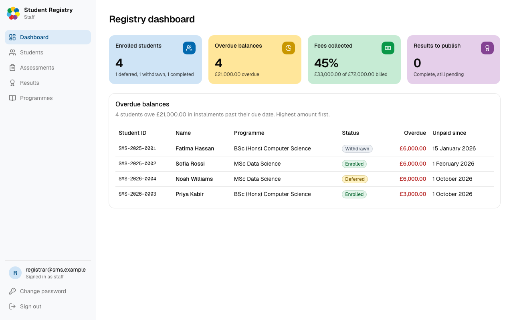
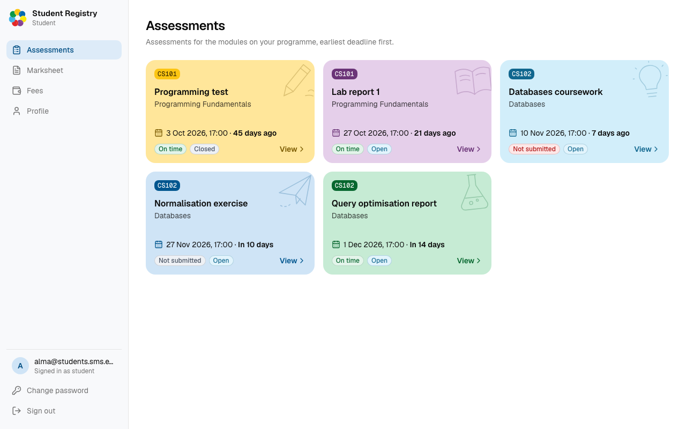

# Student Registry

The Registry module of a Student Management System.
It covers the four workflows a Registry Administrator runs every day: student enrolment, fees and payments, assessment submissions, and marksheets with controlled release of results.
It is built with Next.js 16 (App Router), PostgreSQL, and Prisma 7.

## Prerequisites

- Node.js 22 or later, with npm.
- Docker Desktop (or another Docker engine with Compose), used to run PostgreSQL.

## Run it locally

1. Install dependencies:

   ```bash
   npm install
   ```

2. Create your environment file and fill in every placeholder (see the comments in the file and the table below):

   ```bash
   cp .env.example .env
   ```

   Use the same PostgreSQL user, password, and port in `DATABASE_URL` and `TEST_DATABASE_URL` as in `POSTGRES_USER`, `POSTGRES_PASSWORD`, and `POSTGRES_PORT`.

3. Start PostgreSQL, which creates the `registry` and `registry_test` databases on first start:

   ```bash
   docker compose up -d
   ```

4. Create the tables and load the demo data:

   ```bash
   npx prisma migrate deploy
   npx prisma db seed
   ```

   The seed replaces everything in the `registry` database with the demo data set, so run it again whenever you want a fresh start.
   Its dates are worked out from the day you run it, so the overdue fees and late submissions are always there.

5. Start the app and open http://localhost:3000:

   ```bash
   npm run dev
   ```

## Environment variables

| Variable | Purpose |
|---|---|
| `POSTGRES_USER` | PostgreSQL user that `docker-compose.yml` creates on first start. |
| `POSTGRES_PASSWORD` | Password for that user. |
| `POSTGRES_PORT` | Host port for PostgreSQL (default `5432`). |
| `DATABASE_URL` | Connection string for the `registry` database used by the app and the seed. |
| `TEST_DATABASE_URL` | Connection string for the `registry_test` database, which the integration and Playwright tests reset on every run. |
| `AUTH_SECRET` | Secret that signs session cookies; generate one with `openssl rand -base64 32`. |
| `SEED_USER_PASSWORD` | Password given to every seeded demo account; at least 8 characters. |
| `UPLOAD_DIR` | Folder for uploaded submission files (default `./uploads`, outside `public/`). |
| `APP_TIMEZONE` | IANA time zone for "today" (fee due dates) and for entering and showing deadlines (default `Europe/London`). |
| `APP_CURRENCY` | ISO 4217 currency code used to show money (default `GBP`). |

Only `.env.example` is committed; `.env` is gitignored.

## Demo accounts

Every demo account signs in with the password you set as `SEED_USER_PASSWORD` in `.env`.

| Role | Email | What it shows |
|---|---|---|
| Staff | `registrar@sms.example` | Every staff page |
| Staff | `registry.officer@sms.example` | A second staff account |
| Student | `alma@students.sms.example` | BSc, fees paid in full, CS101 results published |
| Student | `liam.chen@students.sms.example` | BSc, part-paid but not overdue, a late submission, CS101 results withheld |
| Student | `priya.k@students.sms.example` | BSc, nothing paid yet, CS101 results pending (a grade is missing) |
| Student | `fatima.hassan@students.sms.example` | BSc, withdrawn, overdue fee |
| Student | `sofia.rossi@students.sms.example` | MSc, overdue fee, DS501 results published |
| Student | `daniel.mensah@students.sms.example` | MSc, completed, fees paid in full |
| Student | `noah.williams@students.sms.example` | MSc, deferred, so cannot submit work |

## What it does

**Staff** see a dashboard with the key figures and every student with an overdue balance.
They search and filter students by name, Student ID, programme, or status, create and edit records with a generated Student ID (`SMS-2026-0001`), and record payments against each student's fee.
They set assessments, see every submission with late ones flagged, enter grades, and publish or withhold each student's results module by module.



**Students** see their assessments and upload a PDF or DOCX for each, their marksheet once results are published, their fees with any overdue amount highlighted, and their profile.



Both roles share a sidebar layout that folds into a menu on phones; colours and fonts are set in one place, `src/app/theme.css`.

## Product decisions and assumptions

The brief leaves some rules open; these are the main choices.

- **Login:** email and password with two roles, checked on the server for every page and API route.
  Staff set a student's first password, the student must change it at first sign-in, and staff can reset a forgotten one.
- **Fees:** each programme has an annual fee split into dated instalments.
  A student is **overdue** when they have paid less than the instalments already due; balances are always calculated from the recorded payments.
  Payments need a unique reference, cannot be dated in the future, and cannot exceed the outstanding balance.
- **Submissions:** only Enrolled students can submit, one file each, at most 10 MB, checked by content as well as name.
  Before the deadline a new upload replaces the old one; after it, a first upload is accepted and flagged late, and an existing one is locked.
- **Results:** grades are 0-100, classified Fail below 40, Pass from 40, Merit from 60, and Distinction from 70.
  Results are published or withheld per student per module, and only once every assessment has a grade; adding an assessment returns published results to Pending.
  Students see Pending and Withheld results the same way ("Results not yet released"), and those grades never leave the server.
- **Privacy:** a student asking for another student's data gets a 404, so its existence is not revealed.

**Out of scope:** a "Forgot password?" email, user management, screens for editing programmes and fee plans (they come from the seed), editing or refunding payments, notifications, and deployment.

## How it is built

- `src/domain/`: pure business rules (Student IDs, instalments, balances, submission rules, classification, publishing), covered by unit tests.
- `src/server/`: one service per area, plus authentication, file storage, and error handling.
- `src/app/api/`: Route Handlers for students, fees and payments, assessments and submissions, grades, and results.
  Each checks the session and role, validates input with Zod, calls a service, and returns errors as `{ "error": { "code", "message", "fields" } }`.
- `src/app/`: the pages, React Server Components that load their own data on the server.
  Only forms, filters, and inline actions are Client Components; after a change they call an API route and refresh the page, so there is no client-side store or cache to keep in sync.
- `src/components/`: the shared layout and UI, built with shadcn/ui and Tailwind CSS.
- `prisma/`: the schema, migrations, and seed data; `docs/database-schema.md` has a diagram.

Race conditions are handled in the database: Student IDs come from an atomic counter, and payments, grades, publishing, and uploads lock the student's row.

## API routes

| Method and path | Who | What it does |
|---|---|---|
| `GET, POST /api/students` | Staff | List (with `q`, `programmeId`, `status`) or create students |
| `GET /api/students/[id]` | Staff, the student | Read a student record |
| `PATCH /api/students/[id]` | Staff | Edit a student record |
| `PUT /api/students/[id]/password` | Staff | Set a temporary password the student must change |
| `GET /api/students/[id]/fees` | Staff, the student | Bill, balances, and payment history |
| `POST /api/students/[id]/payments` | Staff | Record a payment |
| `GET /api/assessments` | Staff, students | All assessments with counts, or a student's own |
| `POST /api/assessments` | Staff | Create an assessment |
| `GET, PATCH /api/assessments/[id]` | Staff | Submissions for an assessment; edit, close, or reopen it |
| `POST /api/assessments/[id]/submission` | Students | Upload or replace a file (multipart field `file`) |
| `GET /api/submissions/[id]/file` | Staff, the student | Download a submitted file |
| `PUT /api/assessments/[id]/grades/[studentId]` | Staff | Set or clear a grade |
| `PUT /api/students/[id]/modules/[moduleId]/result` | Staff | Publish, withhold, or return results to pending |
| `POST /api/modules/[id]/publish` | Staff | Publish every complete, pending result on a module |
| `GET /api/students/[id]/results` | Staff, the student | The student's marksheet (published modules only) |

## React components and state

**Server Components:** all pages and layouts.
They run on the server, check who is signed in, and load their data directly from `src/server/`.
The browser gets ready HTML, and no data is fetched or cached in the browser.

**Client Components (`"use client"`):** only the parts the user interacts with.

- Forms: add or edit a student, record a payment, create an assessment, upload a file, sign in, and change password.
- Inline actions: enter a grade, publish or withhold results, and close or reopen an assessment.
- Navigation: the student search and filters, the current-page highlight, and the phone menu.

**State:**

- There is no global store such as Redux or Context; each piece of state stays in the component that uses it.
- Forms use `useState` for errors and the loading state; sign-in and change-password use `useActionState` with Server Actions.
- After a change, a component calls the API and then `router.refresh()`, so the server draws the page again with fresh data.
- The student search and filters live in the URL, so they survive a reload and can be shared as a link.

## Tests

| Command | What it runs |
|---|---|
| `npm test` | Unit tests for the business rules in `src/domain` |
| `npm run test:integration` | API tests that call the Route Handlers against the `registry_test` database |
| `npm run test:e2e` | Playwright browser tests against a production build and freshly seeded `registry_test` data |

Before the first Playwright run, install its browser once:

```bash
npx playwright install chromium
```

Other checks: `npm run lint` and `npm run typecheck`.

The Playwright tests are named after the scenarios in the specs under `openspec/changes/*/specs/`, and `e2e/journey.spec.ts` follows one student from enrolment to a released result across both roles.
The tests that add data of their own (new students, changed passwords, published results) run after the ones that expect only the seeded data; `playwright.config.ts` sets this order.

## How AI was used

I built this project with Claude Code (Anthropic) as my pair programmer, and I stayed in charge of every step.
I decided how every feature should behave, set the rules for how the code had to be planned, written, tested, and checked the critical parts myself.

- **Setting up the workflow:** before any code was written, I set up the rules the AI had to follow in `AGENTS.md`: plan every feature as an OpenSpec change first, build it test-first, give every user-facing behaviour a Playwright test, and fix lint errors and flaky tests when they appear.
  I also added the OpenSpec workflow and the test-driven development skill to the project.
- **Planning with OpenSpec:** the brief was turned into an OpenSpec change (`openspec/changes/build-registry-module/`) with a proposal, five capability specs written as testable scenarios, a design, and a task list.
  Before any code was written, the AI asked about the choices the brief leaves open, and I decided them: email and password login, fees in instalments, local file storage, and publishing per student per module.
- **Building test-first:** each slice started with a failing test at one of three seams I approved (pure domain functions, API routes against a real test database, and Playwright in a real browser), then the code to pass it.
  Nothing internal is mocked; the only thing tests set is who is signed in.
- **Improving it after the first build:** I chose each later improvement, and each went through the same steps as its own OpenSpec change: password change and reset, the sidebar and dashboard summary cards, Student IDs in staff URLs, and the restyled Assessments, Results, Marksheet, and Programmes pages.
  For the restyled pages, the AI first drew design mockups, and I picked a direction and adjusted it before any plan was written.
- **Final review against the brief:** I had the whole project tested against the brief by hand and with the full test suite.
  When any bugs were found, I decided how each should be fixed.
- **What I checked myself:** I reviewed the plan and the summary of each part, and decided every product question above.
  I personally checked the crucial parts: authentication and authorization (sign-in, roles, and students reaching only their own data), result publishing and withholding, and the overdue fee logic.

Each change's `tasks.md` under `openspec/changes/` shows the order its work was done in, starting with `build-registry-module`.
