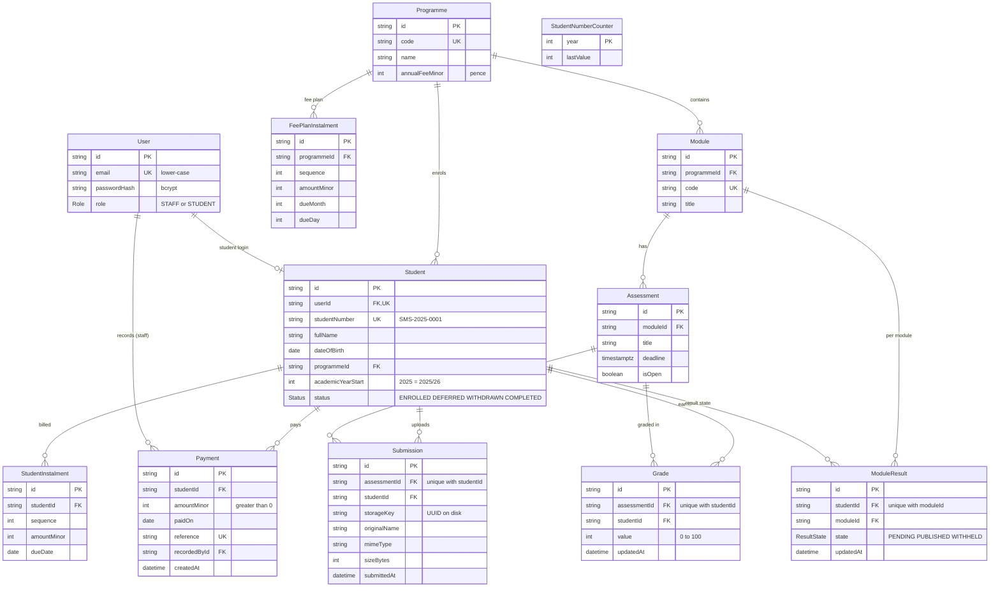

# Database schema

This ER diagram shows the planned PostgreSQL schema that `prisma/schema.prisma` will define.
It follows the data model in `openspec/changes/build-registry-module/design.md` (decision 3).
GitHub and most Markdown previewers render the Mermaid block below as a diagram.

## Notes

- `StudentNumberCounter` stands alone: it holds one row per year and hands out Student ID numbers atomically.
- A staff user has no `Student` row; `Payment.recordedById` points to the staff user who recorded the payment.
- Money is stored as integer minor units (pence) in the `amountMinor` and `annualFeeMinor` columns.
- Balances, the late flag, and grade classifications are calculated when read and are not stored.
- A missing `ModuleResult` row means the module's results are `PENDING` for that student.
- PK, FK, and UK map to Prisma `@id`, relation fields, and `@unique`; the "unique with" pairs map to `@@unique([assessmentId, studentId])` and `@@unique([studentId, moduleId])`.
